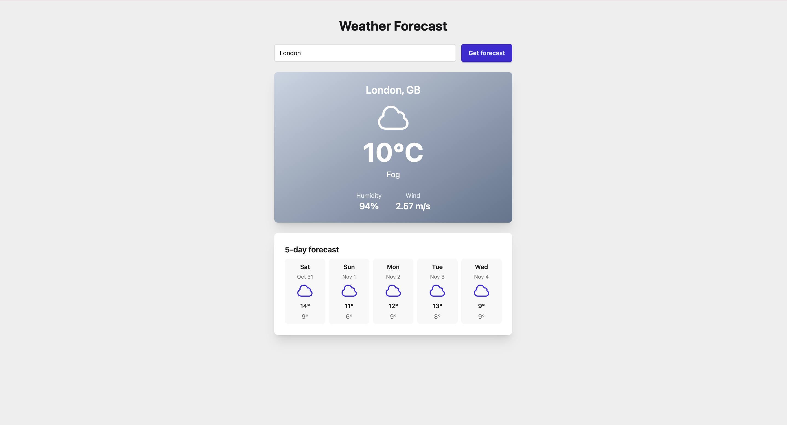
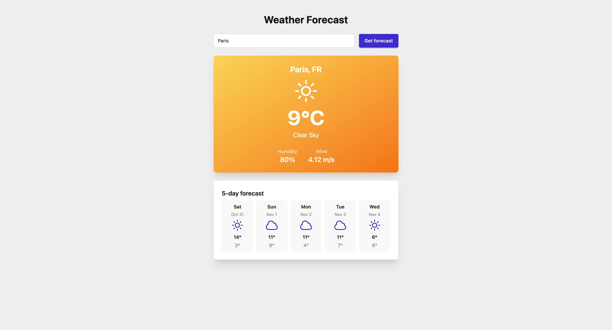

# Weather Test App




# How to launch
1) Clone this repository
2) Run the following commands:
  ```bash
npm install
  ```
  ```bash 
  npm start
  ```

3) Open http://localhost:4200 in your browser
